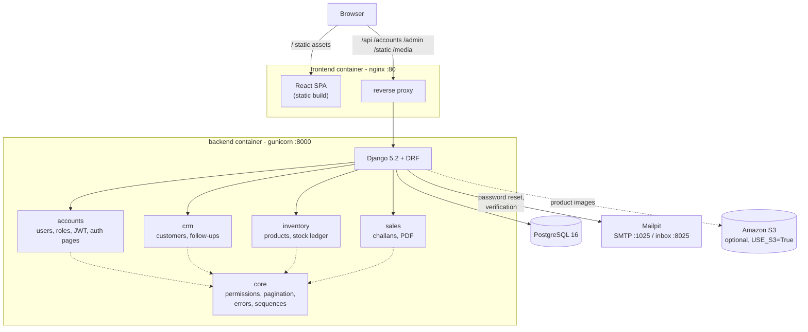
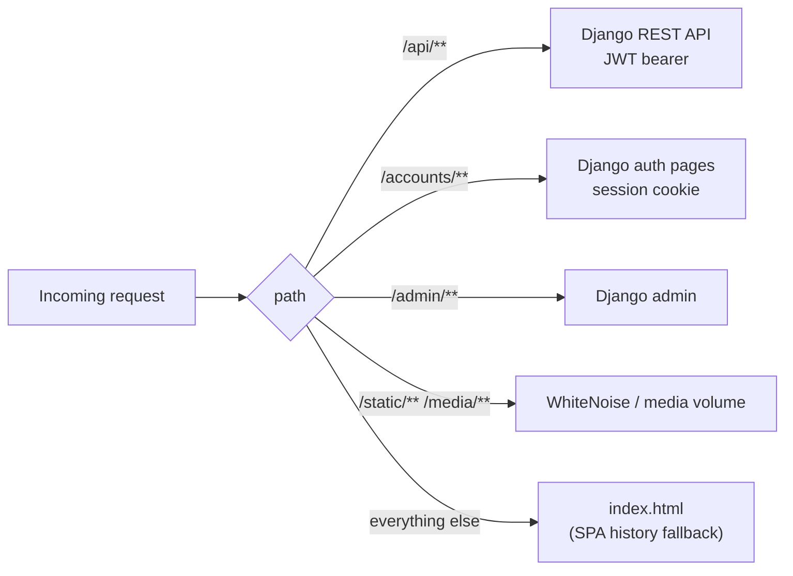
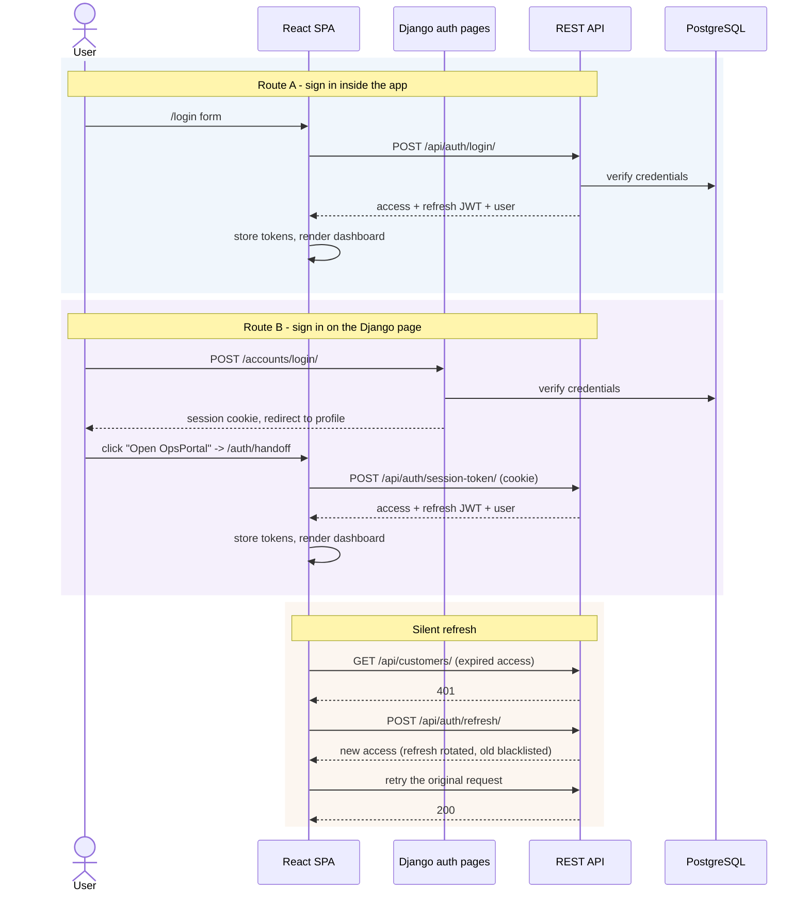
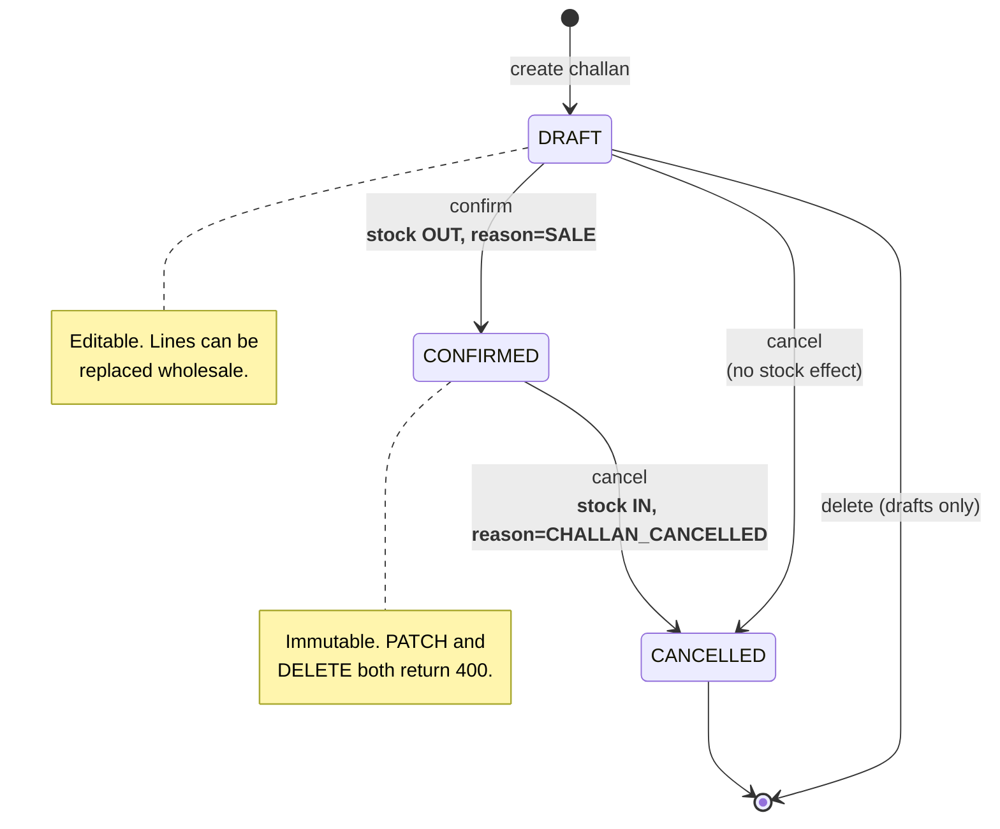
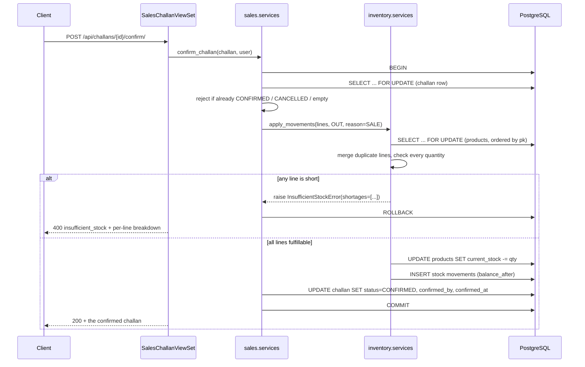
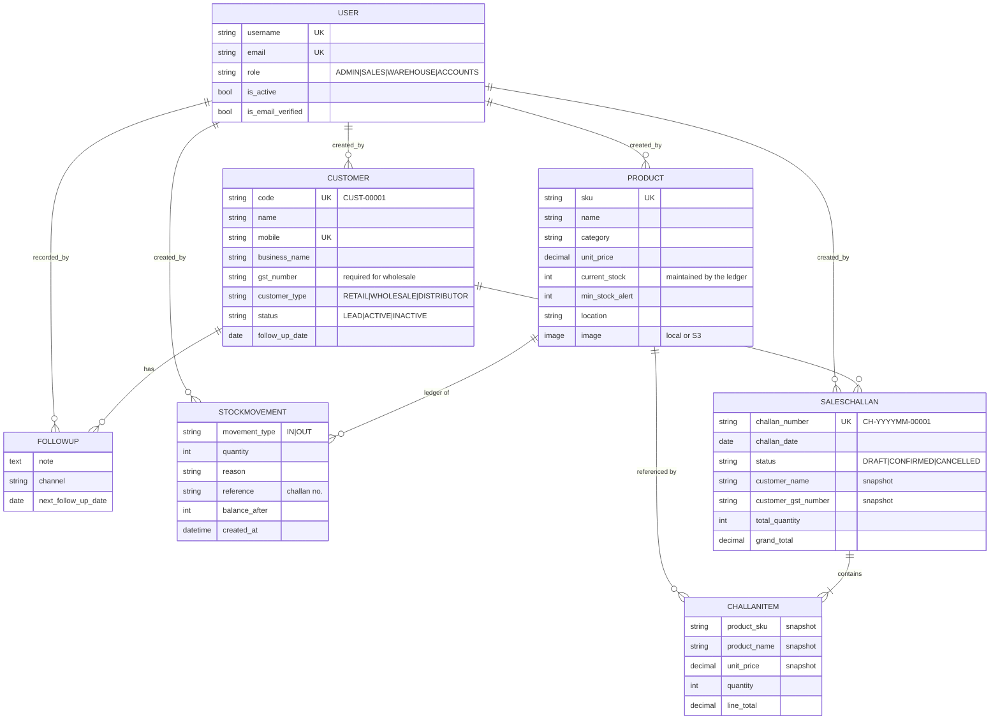
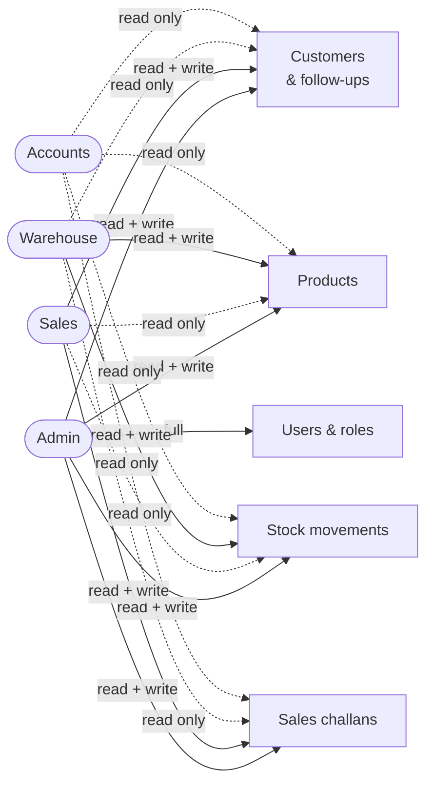
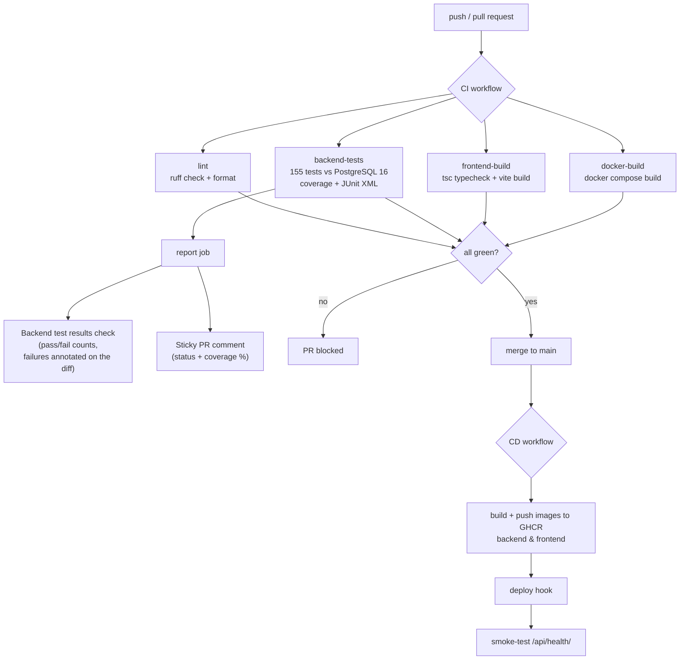
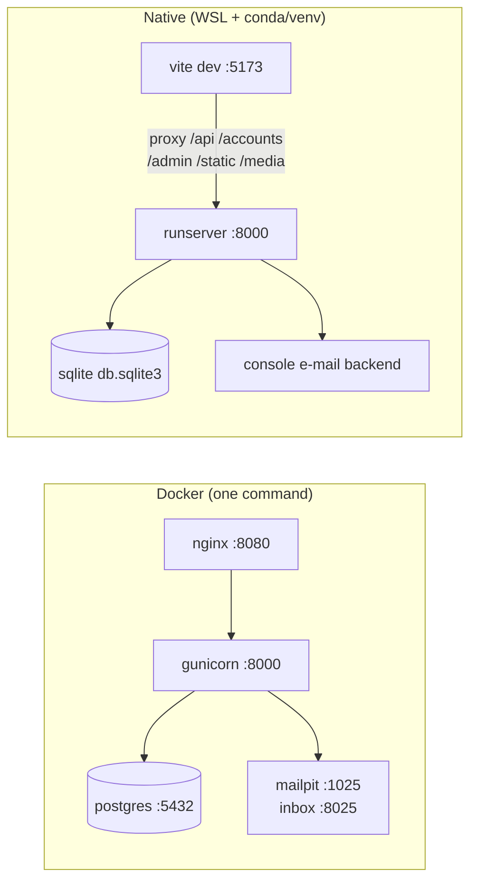

# OpsPortal — Architecture

All diagrams are Mermaid, which GitHub renders natively in Markdown.

---

## 1. System overview

Everything is served through nginx on a single origin, so the session cookie
Django sets on its login page is also sent to `/api/auth/session-token/`. That is
what makes the SPA handoff work — and it removes CORS and CSRF friction entirely.

---

## 2. Request paths through nginx

---

## 3. Authentication — two surfaces, one session

---

## 4. Challan state machine

Stock only moves on the transitions marked in bold. A draft reserves nothing.

---

## 5. Confirming a challan — the concurrency-safe path

Two sales users clicking *Confirm* at the same instant serialise on the product
row locks instead of both passing the stock check.

---

## 6. Data model

**Why the snapshot columns.** `CHALLANITEM` copies the product's name, SKU,
category, unit and price at save time, and `SALESCHALLAN` copies the customer's
billing details. Renaming or repricing a product later must never rewrite an
already-issued document — there is a test for exactly this.

---

## 7. Role permission matrix

Declared once per viewset via `core.permissions.RolePermission` and mirrored in
`frontend/src/auth/permissions.ts` — the frontend copy only decides what to
*offer*; the server is always the enforcer.

---

## 8. CI/CD pipeline

---

## 9. Local development topology

The Vite dev proxy forwards the same paths nginx does, so the two environments
behave identically — including the session→JWT handoff.
